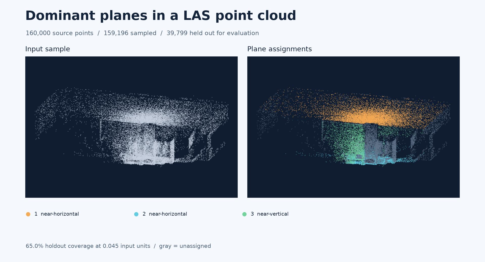

# LAS Plane Inspector

Extract dominant planar surfaces from a large LAS or LAZ scan. Use the comparison image, plane equations and held-out residuals to check which surfaces are visible in the scan before tracing them or using them as references in BIM.



## Run the real example

Use Python 3.10 or later. From the root of this repository, run:

```sh
python -m pip install -e .
las-plane-inspect examples/34-subset.las --threshold 0.045 --bbox -0.9 -5.2 -1.5 10 10.7 2.5 --planes 3 --export-ply --output results/example
```

The example contains 160,000 uniformly sampled points from a measured building scan. The run finds two near-horizontal planes and one near-vertical plane. At the selected threshold, about **65.0%** of the 39,799 held-out points are assigned to a plane. This number reports geometric coverage in the cropped scan. [Example report](examples/34-report.json)

| Output | Use |
| --- | --- |
| `preview.png` | Compare the same held-out points before and after plane assignment. |
| `planes.csv` | Read each plane equation, angle to XY, inlier count, RMSE and 95th-percentile distance. |
| `report.json` | Check input and crop counts, sampling settings, held-out coverage and how coverage changes at half and twice the threshold. |
| `segmented.ply` | Inspect the sampled points and their plane IDs in a viewer such as CloudCompare. Add `--export-ply` to generate this file. |

## Run on your own scan

```sh
las-plane-inspect your-scan.las --threshold 0.03 --planes 4 --max-points 250000 --output results/site-a
```

- Set `--threshold` in **the input coordinate units**. Choose a distance appropriate to the scan noise and the surface detail you want to retain.
- Use `--bbox xmin ymin zmin xmax ymax zmax` to restrict the analysis to a room, facade or other region. Omit it to sample the full scan.
- Install with `python -m pip install -e ".[laz]"` to enable compressed LAZ input.
- Run `las-plane-inspect --help` for plotting and RANSAC controls.

## Full-size case study

Download the original **34.las** (65,245,573 points, about 1.30 GB) from the [v0.1.0 release](https://github.com/daixy7891-beep/las-plane-inspector/releases/tag/v0.1.0).

```sh
las-plane-inspect 34.las --threshold 0.045 --bbox -0.9 -5.2 -1.5 10 10.7 2.5 --max-points 600000 --planes 3 --trials 400 --output results/full
```

On the full-file run, **97,003 of 150,000 held-out points** fell within the threshold. This crop yielded three fitted planes. The plane equations use the original LAS coordinate frame.

| Plane | Angle to XY | Held-out inliers | Inlier RMSE |
| --- | ---: | ---: | ---: |
| Upper near-horizontal | 0.22° | 54,418 | 0.00854 |
| Lower near-horizontal | 0.33° | 24,692 | 0.00685 |
| Near-vertical | 89.96° | 17,893 | 0.00512 |

Distances in this case study use the native coordinate units. The subset preserves the original point records and uses seed 781 to draw points uniformly without replacement. The original and subset are published with permission. The MIT license applies to the project code. [Full scan report](examples/full-scan-report.json) · [Plane equations and residuals](examples/full-scan-planes.csv)

## How the evaluation works

The reader streams the file in chunks and uniformly samples points inside the requested crop. The tool reserves 25% of the sample for evaluation. RANSAC repeatedly proposes planes from three points, selects the candidate with the most support and refines it by orthogonal least squares. Assigned inliers are removed from the fitting pool before the search for the next plane. [RANSAC paper](https://doi.org/10.1145/358669.358692)

Each held-out point is assigned to its closest plane if the distance is within the threshold. The reported RMSE uses these accepted points. Coverage and RMSE can be interpreted together to judge how much of the sampled scan each plane represents. The geometry labels describe orientation relative to the input XY plane. Separated surfaces on the same infinite plane can be grouped together. Semantic component labels and wall boundaries require further analysis.

## 中文简介

面向 Scan-to-BIM 前处理的建筑点云工具。可从 LAS/LAZ 逐块读取和抽样，使用 RANSAC 提取主平面，再用留出点统计平面覆盖率与距离残差。对比图和带颜色的 PLY 便于检查现场扫描中哪些区域适合用平面表示。

## Tests

```sh
python -m unittest discover -s tests
```
